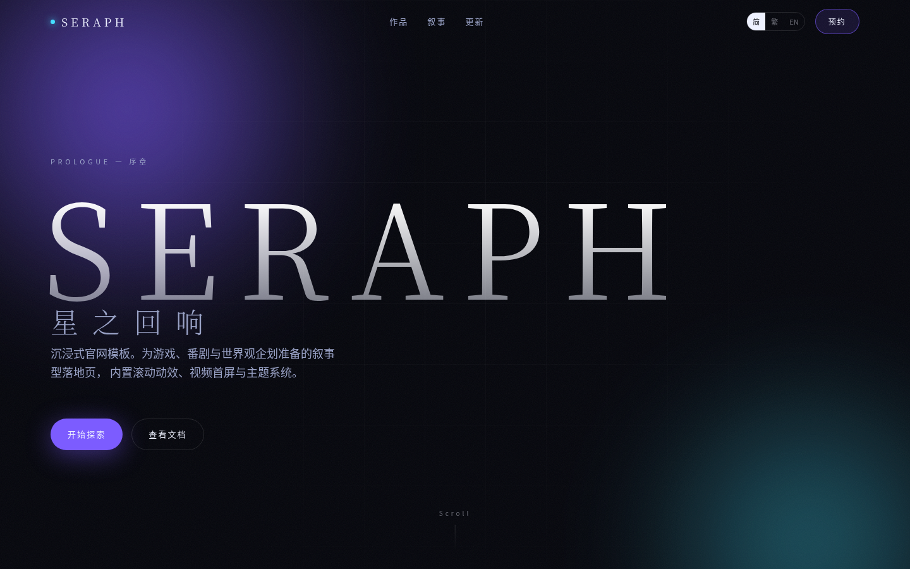

<div align="center">

# Immersive Site Template

**沉浸式官网模板** · 面向游戏、番剧与世界观企划的两种页面形态

演示品牌：SERAPH

**零框架运行时** · Vite · TypeScript · GSAP · Lenis

[滚动叙事版](https://huangqi-an.github.io/immersive-site-template/) ·
[单屏切页版](https://huangqi-an.github.io/immersive-site-template/single-screen/) ·
[源码](https://github.com/huangqi-an/immersive-site-template)

</div>



---

## 两种页面形态

| | 滚动叙事 `scroll-story` | 单屏切页 `single-screen` |
|---|---|---|
| 交互模型 | 文档流滚动，章节随滚动推进 | 固定视口，点击/滚轮/方向键切屏 |
| 适合 | 有大量文案与设定的长篇官网 | 以 KV、立绘、PV 为主的首屏型官网 |
| 动画主力 | ScrollTrigger（pin / scrub / reveal） | GSAP timeline（进出场编排） |
| 页面滚动 | 有 | **没有**，`body` 锁死，切换靠状态 |
| 入口 | `/` | `/single-screen/` |

两者共用同一套设计令牌与行为层，差异只在「导航模型」。

## 为什么没有框架

这类页面的标记是**内容**，不是逻辑。挂一个 Vue/React 运行时进来，换来的是
`v-for` 和组件封装，代价是版本升级债、构建配置和约 25KB 的运行时。

所以这里只有 HTML + CSS + 少量 TS：

- 结构直接写在 `index.html` 里，**加/删/调顺序都是改 HTML**，不用改路由或组件树
- 行为靠 `data-*` 属性声明式挂载（`data-reveal`、`data-pin-gallery`、`data-screen`）
- 控制器都做空值判断：页面上没有对应元素就跳过，不会因为删了一个 section 报错

## 这是什么

一套可组合的官网骨架。改 `tokens.css` 换视觉，改 section 顺序换结构，
不需要重写动画逻辑——`src/shared/` 里的滚动、揭示、预加载、切屏都不依赖任何框架。

## 这不是什么

- **不是通用组件库**。不提供按钮、表单这类基础组件，只解决「官网型页面」的叙事结构。
- **不包含任何美术素材**。所有图都是 CSS 合成的占位背景，需要你替换成自己的 KV、立绘或视频。
- **不是某款游戏的复刻**。演示文案为原创占位内容，与任何商业作品无关。

## 特性

| | |
|---|---|
| **零框架** | 无 Vue/React 运行时，JS 只有 GSAP + Lenis |
| **滚动叙事** | GSAP ScrollTrigger + Lenis，`raf` 挂在 `gsap.ticker` 上，进度不抖帧 |
| **横向画廊** | 桌面端 pin + scrub，移动端自动退化为原生横向滚动 + scroll-snap |
| **单屏切页** | 屏幕常驻 DOM，靠 `visibility` 切换；连点可打断上一条时间线，不丢输入 |
| **预加载** | 等待字体/关键资源 + 最短展示时长，避免 loading 一闪而过 |
| **可降级** | `prefers-reduced-motion` 下不初始化平滑滚动，切屏直接切换，动画全部跳过 |
| **垂直适配** | 单屏版内置竖屏提示，横屏体验不被挤压 |
| **主题令牌** | 颜色、字体、间距、缓动集中在 `src/styles/tokens.css` |

## 快速开始

```bash
npm install
npm run dev      # / 和 /single-screen/ 同时可用
npm run build    # tsc 类型检查 + 双入口构建
```

构建产物是纯静态文件，可以直接扔到任何静态托管上，不需要 Node 运行时。

## 部署

推送到 `main` 会触发 `.github/workflows/deploy.yml`：构建 → 上传产物 → 发布到 GitHub Pages。
`base` 由仓库名自动推导，改仓库名不用动配置。

**首次使用需要手动做一步**：仓库 `Settings → Pages → Source` 选 **GitHub Actions**。
`GITHUB_TOKEN` 无权通过 API 创建 Pages 站点（会报 `Resource not accessible by integration`），
所以这一步没法自动化，只能点一次。

## 目录结构

```
index.html                     滚动叙事模板的全部标记（改结构就改这里）
single-screen/index.html       单屏模板的全部标记
src/
├── shared/                    框架无关的行为层，纯 TS
│   ├── smoothScroll.ts        Lenis + GSAP ticker 同步，返回 destroy()
│   ├── reveal.ts              [data-reveal] 进入视口淡入
│   ├── worksGallery.ts        [data-pin-gallery] 横向 pin + scrub
│   ├── pageSwitch.ts          [data-screen] 切屏状态机
│   └── preloader.ts           资源就绪 + 最短展示时长
├── styles/
│   ├── tokens.css             设计令牌
│   └── base.css               reset + 版式工具（滚动版用）
└── demos/
    ├── scroll-story/
    │   ├── main.ts            行为装配（哪个 data-* 挂哪个模块）
    │   └── sections/*.css     每个章节一个样式文件
    └── single-screen/
        ├── main.ts            切屏装配 + 预加载接线
        └── screens.css        页面级样式（接管 body overflow）
```

## 定制

**换主题**：只改 `src/styles/tokens.css` 里的变量。`--accent` / `--accent-2` 决定整站色相。

**加一个章节**：在 `index.html` 里粘一段 `<section>`，内容元素加 `data-reveal` 就有入场动画；
需要新样式就在 `src/demos/scroll-story/sections/` 建同名 `.css` 并在 `main.ts` 里多引一行。
不需要注册组件、不需要改路由。

**调顺序 / 删章节**：直接改 HTML 的位置或删掉整段即可，JS 不会因为找不到元素而报错。

**加一屏**：在 `single-screen/index.html` 里复制一个 `<section data-screen>`，
改 `--accent` 和文案，再到 `.navbar__dots` 补一个 `data-dot` 按钮。
屏幕数量由 DOM 决定，不用改 TS。

**替换首屏为视频**：在 `index.html` 的 `.hero__bg` 内加

```html
<video class="hero__video" autoplay muted loop playsinline poster="/kv.jpg">
  <source src="/kv.webm" type="video/webm" />
</video>
```

并补一条 `.hero__video { position: absolute; inset: 0; object-fit: cover; }`。

## 性能与降级

| 入口 | JS (gzip) | 说明 |
|---|---|---|
| scroll-story | ~51KB | 23.4KB 业务 + 27.6KB 共享 GSAP/Lenis |
| single-screen | ~29KB | 1.4KB 业务 + 27.6KB 共享 GSAP/Lenis |

- 共享依赖由 Vite 自动拆成独立 chunk，两个入口复用同一份
- 移动端与 `prefers-reduced-motion` 下不启用 pin 与平滑滚动
- 所有动画作用在 `transform` / `opacity` 上，不触发重排

## 浏览器支持

Chrome / Edge / Safari 最新两个版本，Firefox 最新版。
`overflow: clip` 与 `backdrop-filter` 用于吸顶与导航毛玻璃，Safari 16+ 起完整支持。

## Roadmap

- [ ] Vitest 覆盖 shared 层（reveal 降级分支、preloader 最短时长、pageSwitch 边界）
- [ ] Playwright 视觉回归（防止改动画改崩版式）
- [ ] 可选适配包：把 `shared/` 包成 Vue / React composable（核心保持无框架）
- [ ] 主题预设（暗色 / 亮色 / 高对比）
- [ ] 多语言路由示例（繁 / 简 / EN）

## 许可证

代码 [MIT](./LICENSE)。`docs/preview.png` 为本项目截图，可自由使用。
仓库内**不含**任何第三方美术素材、字体或商标；接入真实素材前请自行确认授权。
